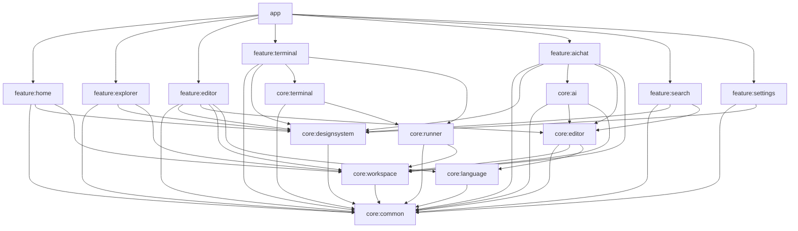

# VibeSpace Architecture Guide

## 1. High-Level Architecture Overview

**VibeSpace** is an advanced native Android coding IDE inspired by modern desktop developer environments (like VS Code), engineered specifically for touchscreens, mobile chipsets, and Android sandboxing.

It is **NOT** a web application wrapped in an Android WebView. Every screen, editor surface, tree node, and panel is built with native Jetpack Compose and idiomatic Kotlin.

```
+-----------------------------------------------------------------------------------+
|                                     app (:app)                                    |
|              MainActivity • VibeSpaceApplication • VibeNavigation                 |
+-----------------------------------------------------------------------------------+
         |                                                       |
         v                                                       v
+-------------------------------+               +-----------------------------------+
|         FEATURE MODULES       |               |            CORE MODULES           |
| • :feature:home               |               | • :core:common                    |
| • :feature:explorer           |               | • :core:designsystem              |
| • :feature:editor             | ------------> | • :core:workspace                 |
| • :feature:terminal           |               | • :core:language                  |
| • :feature:aichat             |               | • :core:editor                    |
| • :feature:search             |               | • :core:runner                    |
| • :feature:settings           |               | • :core:terminal                  |
+-------------------------------+               | • :core:ai                        |
                                                +-----------------------------------+
```

---

## 2. Module Dependency Graph & Isolation Rules



### Module Isolation Rules:
1. **Strict Core Independence**: Core modules must never depend on feature modules.
2. **Feature Isolation**: Feature modules must never depend directly on other feature modules. All inter-feature communication happens through shared Core contracts or top-level navigation in `:app`.
3. **No Circular Dependencies**: Dependencies flow strictly downward from `app` -> `feature` -> `core` -> `common`.
4. **Android File Path Realities**: The application must never assume every file has a standard `/home/user` POSIX path. VibeSpace supports Android Storage Access Framework (`content://` URIs) and app-isolated storage through `VirtualFile`.

---

## 3. Data Flow & Concurrency Architecture

- **State Management**: Unidirectional Data Flow (UDF) powered by Kotlin `StateFlow` and Compose `collectAsState()`.
- **Concurrency**: Structured concurrency with `CoroutineScope`. Expensive I/O and text scanning run exclusively on `Dispatchers.IO` and `Dispatchers.Default` via `DispatcherProvider`.
- **Determinism**: Injected `DispatcherProvider` enables fast, reliable, and deterministic unit tests using `TestDispatcherProvider`.

---

## 4. UI Architecture & Responsive Breakpoints

VibeSpace supports three dynamic window size classes:

1. **Compact (< 600dp)**: Smartphone portrait orientation.
   - Screen prioritized for full-screen code editing.
   - Project Explorer presented as a sliding Navigation Drawer.
   - AI assistant presented as an expandable bottom sheet.
   - Terminal presented as a collapsible slide-up drawer.
2. **Medium (600dp - 840dp)**: Large foldables and landscape phones.
   - Navigation Rail with quick toggle actions.
   - Split-screen capable.
3. **Expanded (> 840dp)**: Android tablets, ChromeOS, and Samsung DeX.
   - Permanent 56dp Navigation Rail.
   - Dockable 260dp Project Explorer sidebar.
   - Central multi-tab code editing surface.
   - Dockable 260dp bottom Terminal & Output console.
   - Optional 320dp right-hand AI companion pane.
